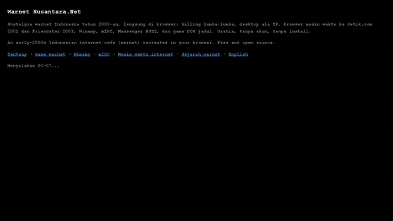

[English](README.md) · **Bahasa Indonesia**

# Warnet Nusantara.Net — PC-07

Nostalgia warnet Indonesia awal 2000-an, langsung di browser.

### [▶ Main sekarang / Play now](https://warnet-nusantara.pages.dev/)

[](https://github.com/kelvindesman/warnet-nusantara/actions)
[](CONTRIBUTING.md#testing-bar)
[](LICENSE)
[](https://github.com/kelvindesman/warnet-nusantara/stargazers)
[](COMMUNITY.md#discord)

[](docs/media/kilas-balik.mp4)

[▶ Tonton kilas balik 2,5 menit (pakai suara)](docs/media/kilas-balik.mp4)

## Kenapa, dalam 30 detik

Kalau kamu besar di Indonesia tahun 2000-an, pasti ingat: bilik bersekat triplek, monitor CRT, wallpaper lumba-lumba, timer billing di pojok, teriakan "MAS, NAMBAH SEJAM!", testimonial Friendster dan `asl pls` di DALnet. Warnet seperti itu sekarang hampir punah. Proyek ini membangunnya lagi, supaya kamu bisa duduk lagi di PC-07, dan supaya yang belum pernah merasakannya bisa ikut mencoba. Tanpa install, tanpa akun, bisa di HP.

**Alur boot:** POST BIOS Award → layar kunci billing warnet (lumba-lumba melompat, voucher acak di kertas tempel) → "selamat datang" → desktop ala XP dengan timer billing yang berjalan.

## Isinya

| Aplikasi | Fungsinya |
| --- | --- |
| **Pilih PC (era)** | Pilih PC di layar billing: **2003** ("Win XP" yang asli), **2011** ("Win 7" yang serba kaca) atau **2015** ("Win 10" yang datar). Tiap era punya layar BIOS/boot, tema desktop, wallpaper, tarif per jam (Rp 3.000 / 4.000 / 5.000) dan tahun Wayback bawaan (2001 / 2010 / 2014) sendiri, plus isinya: bookmark dan situs portal zamannya (Friendster dan Kafegaul; Facebook, Plurk dan Koprol; Instagram, Path dan Tokopedia), game yang lagi rame di semua bilik (Point Blank dan Lost Saga; Dota 2 dan CS:GO) dan bot IRC yang ngobrolin itu semua. Parodi buatan sendiri, tanpa logo vendor. `?era=2011` langsung membuka era itu. |
| **Penjelajah Internet** | Browser sungguhan di dalam jendela. Semua halaman dimuat lewat Wayback Machine, dengan **pemilih tahun (1998–2015)**: detik.com 2001, Kaskus 2001, Friendster 2003, Ragnarok ID 2004, GunBound Boleh… Pilih "Live" untuk web masa kini (banyak situs menolak dibuka di frame). Diawali bunyi **dial-up Telkomnet Instan** yang disintesis. |
| **Winamp** | Winamp 2 asli lewat [Webamp](https://github.com/captbaritone/webamp) (MIT), dimuat dari unpkg saat dibuka. Playlist-nya 4 lagu chiptune yang **dibuat langsung di browser** (tanpa file audio). Kamu bisa seret MP3 sendiri ke jendelanya. |
| **Game Warnet** | 46 game legal plus 14 kenangan. Game DOS klasik jalan **di dalam jendela** lewat emulator Internet Archive (DOOM, Sango Fighter, Command & Conquer, Warcraft II, Worms, Mortal Kombat, NFS, Lemmings…), plus port web (Diablo shareware, 3D Pinball, Prince of Persia, 98.js). Situs yang melarang frame (CS 1.6 di play-cs.com, GTA/Duke3D di dos.zone) dibuka di tab baru. Game online yang masih dimiliki penerbitnya (Ragnarok, GunBound, Point Blank, AyoDance…) dapat **kuil kenangan**: situs lamanya lewat mesin waktu dan tautan ke versi resmi, tanpa server bajakan. |
| **Ranjau / Ular HP** | Minesweeper dan game ular ala HP Nokia, bawaan PC. |
| **IRC Chat** | DALnet ala mIRC dengan bot di #jakarta #bandung #warnet ("asl pls"), plus `/me`, `/nick`, `/join`, `/slap`. |
| **Messenger** | Chat dengan **BUZZ!!!** (jendelanya goyang). |
| Lainnya | My Computer (Deep Freeze!), My Documents, Recycle Bin, Notepad (aturan warnet + file kenangan), Display Properties (wallpaper lumba-lumba), menu Start, Log Off / Turn Off ("Sekarang aman untuk mematikan komputer"). |

### Mesin

- ES module vanilla, **nol dependensi, tanpa build**. Sekitar 100 KB sebelum Winamp dimuat; aplikasi dimuat saat dibutuhkan dengan `import()`.
- Semua ikon SVG inline dan semua suara (chime boot, dial-up, buzz, musik) disintesis dengan WebAudio.
- Mendukung layar sentuh: jendela otomatis penuh di HP, satu ketukan membuka ikon, tekan lama untuk pasang bendera di Ranjau, dan Ular HP bisa di-swipe.

## Jalankan di komputer sendiri

```bash
npm run dev          # atau: python3 -m http.server 3000
```

Buka http://localhost:3000 — tambahkan `#desktop` di URL untuk langsung ke desktop tanpa boot dan login.

## Deploy

**Cloudflare Pages (utama).** Setiap push ke `main` yang lolos gate, `.github/workflows/pages.yml` mendorong file publik (allowlist) ke branch `live`, lalu Cloudflare Pages menyajikan branch itu di https://warnet-nusantara.pages.dev/ (production branch `live`, tanpa build command, output directory `/`). Untuk fork kamu, hosting statis apa pun bisa, termasuk GitHub Pages. Aplikasi memakai path relatif, jadi bisa jalan sebagai situs user/org di `/` maupun situs proyek di subpath seperti `/warnet/`.

**Vercel (masih didukung).**

```bash
npx vercel --prod    # atau import repo di Vercel (Framework preset: Other)
```

Hosting statis saja, tanpa server function. `vercel.json` mengatur header cache.

Mau hosting fork publik? Tolong ganti namanya (lihat [TRADEMARK.md](TRADEMARK.md)) dan tetap sediakan source code sesuai AGPL.

## Ikut berkontribusi

Perbaikan bug, situs jadul, game legal, baris bot IRC dan kenangan warnet, semuanya diterima. Mulai dari [CONTRIBUTING.md](CONTRIBUTING.md); untuk agent AI, mulai dari [AGENTS.md](AGENTS.md). Tempat nongkrong komunitas ada di [COMMUNITY.md](COMMUNITY.md). Patuhi [Kode Etik](CODE_OF_CONDUCT.md) ya.

## Dukung mas operator

Warnet virtual pun ada biayanya. Kalau PC-07 bikin kamu nostalgia, yuk **patungan bayar billing warnet**:

- **Trakteer:** https://trakteer.id/kelvin_desman
- **Saweria:** https://saweria.co/kelvindesman
- **GitHub Sponsors:** https://github.com/sponsors/TODO_GH_SPONSORS
- **Buy Me a Coffee:** https://buymeacoffee.com/kelvindsmn

| Paket | Harga | Kamu dapat |
| --- | --- | --- |
| **Paket 1 Jam** | Rp5.000+ / $3 sekali | Nama kamu di jendela System Properties (About) dan di `KONTRIBUTOR.txt` di PC-07. |
| **Paket Malam** | Rp25.000+ / $10 sekali, atau $5/bulan | Nama kamu di teks berjalan layar billing. |
| **Member VIP** | Rp100.000+ / $20/bulan | Baris bot IRC milikmu sendiri (nick kamu ngomong di #warnet). |
| **Pasang Iklan** | Rp500.000+/bulan / $50+/bulan | Banner retro di halaman Portal Nusantara.Net. |

Sponsor bisnis dan banner: isi [formulir kerja sama](.github/ISSUE_TEMPLATE/kerja-sama.yml) untuk catatan publik singkat, lalu email ke `kelvindsmn@gmail.com` untuk detailnya.

### Pendukung

<!-- SUPPORTERS:START -->
_Belum ada yang patungan. Jadilah yang pertama!_
<!-- SUPPORTERS:END -->

## Lisensi

| Bagian | Lisensi |
| --- | --- |
| Kode (JS, CSS, HTML, script, workflow) | [GNU AGPL-3.0-only](LICENSE) |
| Konten kreatif (teks UI berbahasa Indonesia, baris bot IRC/Messenger, teks kenangan dan aturan, ikon SVG dan gambar lumba-lumba, komposisi chiptune, wallpaper; kecuali foto pihak ketiga di layar billing `img/lock-dolphins.jpg`, lihat [CREDITS.md](CREDITS.md)) | [CC BY-NC-SA 4.0](LICENSE-CONTENT) |
| Nama "Warnet Nusantara.Net" dan logo | Dilindungi, lihat [TRADEMARK.md](TRADEMARK.md) |
| Penggunaan komersial (closed source, white-label, kios, versi beriklan) | Tersedia lisensi komersial, lihat [COMMERCIAL.md](COMMERCIAL.md) |

Kontributor menandatangani [CLA](CLA.md).

## Penafian

Proyek buatan penggemar, non-komersial, untuk nostalgia dan parodi. Tidak berafiliasi dengan atau didukung oleh Microsoft, Nullsoft/Winamp, Yahoo!, Google, Kaskus, Friendster, Telkom, Gravity/Lyto, Valve, maupun perusahaan lain yang disebut; merek dagang milik pemiliknya masing-masing dan hanya dipakai secara nominatif. Situs lama ditampilkan oleh Internet Archive dan game disematkan atau ditautkan dari pihak ketiga sesuai ketentuan mereka. Disediakan apa adanya. Permintaan penghapusan diproses dalam 7 hari. Teks lengkap: [DISCLAIMER.md](DISCLAIMER.md).

## Kredit

Game dan port web milik pembuatnya masing-masing. Semuanya ditautkan atau disematkan dari Internet Archive, d07riv/diabloweb, alula/SpaceCadetPinball, princejs.com, 98.js.org, dos.zone dan play-cs.com. Situs lama berasal dari Internet Archive Wayback Machine. Webamp dibuat oleh Jordan Eldredge dan kontributornya. Daftar lengkap dengan tautan dan ketentuannya: [CREDITS.md](CREDITS.md).
