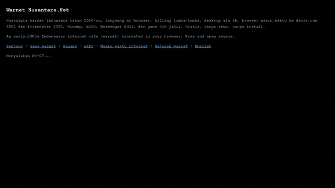

**English** · [Bahasa Indonesia](README.id.md)

# Warnet Nusantara.Net — PC-07

A nostalgia trip to an Indonesian *warnet* (internet café) from the early 2000s, running entirely in the browser.

### [▶ Play now / Main sekarang](https://warnet-nusantara.pages.dev/)

[](https://github.com/kelvindesman/warnet-nusantara/actions)
[](CONTRIBUTING.md#testing-bar)
[](LICENSE)
[](https://github.com/kelvindesman/warnet-nusantara/stargazers)
[](COMMUNITY.md#discord)

[](docs/media/kilas-balik.mp4)

[▶ Watch the 2.5-minute flashback with sound](docs/media/kilas-balik.mp4)

## Why, in 30 seconds

If you grew up in Indonesia in the 2000s, you remember it: a plywood booth, a CRT monitor, a dolphin wallpaper, the billing timer in the corner, "MAS, NAMBAH SEJAM!", Friendster testimonials and `asl pls` on DALnet. Those warnets are mostly gone. This project rebuilds one, so you can sit down at PC-07 again, and so people who never had the chance can see what it felt like. No install, no account, works on a phone.

**Boot flow:** Award BIOS POST → warnet billing lock screen (jumping dolphins, random voucher on a sticky note) → "selamat datang" → XP-style desktop with a live billing timer.

## What's inside

| App | What it does |
| --- | --- |
| **Pilih PC (eras)** | Pick your PC on the billing screen: **2003** (the original "Win XP"), **2011** (glassy "Win 7") or **2015** (flat "Win 10"). Each era has its own BIOS/boot screen, desktop theme, wallpaper, hourly rate (Rp 3.000 / 4.000 / 5.000) and default Wayback year (2001 / 2010 / 2014), plus its own content: bookmarks and portal sites of the time (Friendster and Kafegaul; Facebook, Plurk and Koprol; Instagram, Path and Tokopedia), the games every booth was playing ("Lagi rame": Point Blank and Lost Saga; Dota 2 and CS:GO) and IRC bots talking about them. Hand-made parodies, no vendor logos. `?era=2011` links straight to one. |
| **Penjelajah Internet** | A real browser in a window. Every page loads through the Wayback Machine, with a **year picker (1998–2015)**: detik.com 2001, Kaskus 2001, Friendster 2003, Ragnarok ID 2004, GunBound Boleh… Choose "Live" for today's web (many sites refuse to load in frames). Starts with a synthesized **Telkomnet Instan dial-up** handshake. |
| **Winamp** | Real Winamp 2 via [Webamp](https://github.com/captbaritone/webamp) (MIT), lazy-loaded from unpkg. The playlist is 4 chiptunes **generated in the browser** (no audio files). You can drag your own MP3s onto it. |
| **Game Warnet** | 46 legal games plus 14 memorials. DOS classics run **inside the window** through the Internet Archive emulator (DOOM, Sango Fighter, Command & Conquer, Warcraft II, Worms, Mortal Kombat, NFS, Lemmings…), plus web ports (Diablo shareware, 3D Pinball, Prince of Persia, 98.js). Sites that block framing (play-cs.com CS 1.6, dos.zone GTA/Duke3D) open in a new tab. Online games still owned by their publishers (Ragnarok, GunBound, Point Blank, AyoDance…) get a **memorial** instead: the old site through the time machine and a link to the official version, never a private server. |
| **Ranjau / Ular HP** | Built-in minesweeper and Nokia-style snake games. |
| **IRC Chat** | mIRC-style DALnet with #jakarta #bandung #warnet bots ("asl pls"), plus `/me`, `/nick`, `/join`, `/slap`. |
| **Messenger** | Instant messaging with **BUZZ!!!** (it shakes the window). |
| Others | My Computer (Deep Freeze!), My Documents, Recycle Bin, Notepad (warnet rules + a memories file), Display Properties (dolphin wallpaper), Start menu, Log Off / Turn Off ("Sekarang aman untuk mematikan komputer"). |

### Engine

- Vanilla ES modules, **zero dependencies, no build step**. About 100 KB before Winamp loads; apps load on demand with `import()`.
- All icons are inline SVG and every sound (boot chime, dial-up, buzz, music) is synthesized with WebAudio.
- Supports touch: windows open maximized on phones, a single tap opens icons, long-press places a flag in Ranjau, and Ular HP has swipe controls.

## Run locally

```bash
npm run dev          # or: python3 -m http.server 3000
```

Open http://localhost:3000 — add `#desktop` to the URL to skip the boot and login.

## Deploy

**Cloudflare Pages (primary).** On every push to `main` that passes the gate, `.github/workflows/pages.yml` pushes the allowlisted public files to the `live` branch, and Cloudflare Pages serves that branch at https://warnet-nusantara.pages.dev/ (production branch `live`, no build command, output directory `/`). Any static host works for your own fork, including GitHub Pages. The app uses relative paths, so it works both as a user/org site at `/` and as a project site under a subpath such as `/warnet/`.

**Vercel (still supported).**

```bash
npx vercel --prod    # or import the repo in Vercel (Framework preset: Other)
```

Static hosting only, no server functions. `vercel.json` sets the cache headers.

Hosting a public fork? Please rename it (see [TRADEMARK.md](TRADEMARK.md)) and keep the AGPL source offer.

## Contributing

Bug fixes, old websites, legal games, IRC bot lines and warnet memories are all welcome. Start with [CONTRIBUTING.md](CONTRIBUTING.md); agents start with [AGENTS.md](AGENTS.md). Community spaces are in [COMMUNITY.md](COMMUNITY.md). Please follow the [Code of Conduct](CODE_OF_CONDUCT.md).

## Support the operator

Running a warnet is not free, even a virtual one. If PC-07 brought back memories, help us **patungan bayar billing warnet** (chip in for the warnet bill):

- **Trakteer:** https://trakteer.id/kelvin_desman
- **Saweria:** https://saweria.co/kelvindesman
- **GitHub Sponsors:** https://github.com/sponsors/TODO_GH_SPONSORS
- **Buy Me a Coffee:** https://buymeacoffee.com/kelvindsmn

| Tier | Price | You get |
| --- | --- | --- |
| **Paket 1 Jam** | Rp5.000+ / $3 one-time | Your name in the System Properties (About) window and in `KONTRIBUTOR.txt` on PC-07. |
| **Paket Malam** | Rp25.000+ / $10 one-time, or $5/month | Your name in the lock-screen ticker. |
| **Member VIP** | Rp100.000+ / $20/month | Your own IRC bot line (your nick says your line in #warnet). |
| **Pasang Iklan** | Rp500.000+/month / $50+/month | A retro banner on the Portal Nusantara.Net home page. |

Business sponsorships and banners: use the [kerja-sama form](.github/ISSUE_TEMPLATE/kerja-sama.yml) for a short public note and email `kelvindsmn@gmail.com` for details.

### Supporters

<!-- SUPPORTERS:START -->
_Belum ada yang patungan. Jadilah yang pertama!_
<!-- SUPPORTERS:END -->

## License

| Part | License |
| --- | --- |
| Code (JS, CSS, HTML, scripts, workflows) | [GNU AGPL-3.0-only](LICENSE) |
| Creative content (Indonesian UI copy, IRC/Messenger bot lines, memories and rules texts, inline SVG icons and dolphin art, chiptune compositions, wallpapers; except the third-party lock-screen photo `img/lock-dolphins.jpg`, see [CREDITS.md](CREDITS.md)) | [CC BY-NC-SA 4.0](LICENSE-CONTENT) |
| The name "Warnet Nusantara.Net" and logo | Reserved, see [TRADEMARK.md](TRADEMARK.md) |
| Commercial use (closed source, white-label, kiosk, ad-supported) | Commercial license available, see [COMMERCIAL.md](COMMERCIAL.md) |

Contributors sign the [CLA](CLA.md).

## Disclaimer

Fan-made, non-commercial nostalgia and parody. Not affiliated with or endorsed by Microsoft, Nullsoft/Winamp, Yahoo!, Google, Kaskus, Friendster, Telkom, Gravity/Lyto, Valve or any other company mentioned; their trademarks belong to their owners and are used nominatively only. Old websites are served by the Internet Archive and games are embedded or linked from third parties under their own terms. Provided as is. Takedown requests are honoured within 7 days. Full text: [DISCLAIMER.md](DISCLAIMER.md).

## Credits

Games and web ports belong to their creators. They are linked or embedded from Internet Archive, d07riv/diabloweb, alula/SpaceCadetPinball, princejs.com, 98.js.org, dos.zone and play-cs.com. Old websites come from the Internet Archive Wayback Machine. Webamp is by Jordan Eldredge and contributors. Full list with links and terms: [CREDITS.md](CREDITS.md).
